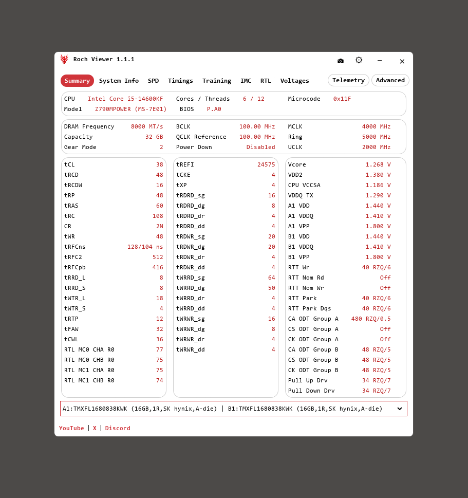

# Roch Viewer 1.1.1

A read-only Windows tool for memory timings, hardware details and live telemetry on supported Intel and AMD systems. Built in Rust, with customizable themes and Summary layouts.



## Get started

Windows 10/11 x64. No Python, .NET or Rust installation needed to run.

1. Download `RochViewer.exe` from [Releases](https://github.com/RochStudio/Roch-Viewer/releases/latest).
2. Place the separately obtained [inpoutx64.dll](https://www.highrez.co.uk/downloads/inpout32/) beside `RochViewer.exe`.
3. Open the viewer and accept the administrator prompt.

Readings depend on your hardware, BIOS and driver access. See the [reference](docs/reference.md) for support and driver details.

## Build

With stable Rust and Visual Studio C++ Build Tools installed:

```powershell
cargo build --release --locked
```

Output: `target\release\RochViewer.exe`. Tests: `cargo test --workspace --locked`.

Created by **Roch Studio / MateoPCTech**.

[YouTube](https://www.youtube.com/@MateoPcTech) | [X](https://x.com/MateoPCTech) | [Discord](https://discord.gg/KfzExpKQHB)

[License](LICENSE) · [Credits and third-party notices](THIRD_PARTY_NOTICES.txt) · [Changelog](CHANGELOG.md)
