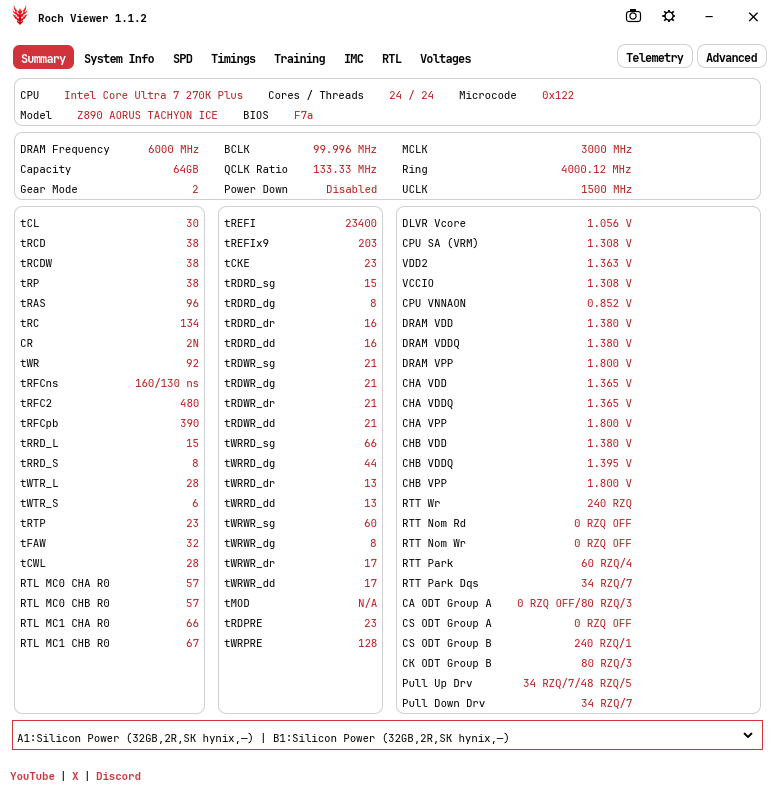

# Roch Viewer 1.1.2

A read-only tool for memory timings, hardware details and live telemetry on Intel LGA1700, Intel LGA1851 and AMD AM5, on Windows and Linux. Built in Rust, with customizable themes and Summary layouts.



## Supported platforms

| Platform | Memory | Windows | Linux |
| --- | --- | --- | --- |
| Intel LGA1851 (Z890) | DDR5 | Yes | Yes, tested on hardware |
| Intel LGA1700 (Z690/Z790) | DDR5 and DDR4 | Yes | Yes, not yet tested on hardware |
| AMD AM5 (Ryzen 9000, with Ryzen 7000 experimental) | DDR5 | Yes | Yes, not yet tested on hardware |

On Linux, every platform builds and passes its tests, but only LGA1851 has been run on real hardware so far. Reports from other boards are welcome.

## Get started

### Linux

No driver to fetch, and no Rust needed. It needs glibc 2.35 or newer, which means Ubuntu 22.04, Debian 12, Fedora 36 or anything since.

1. Download `RochViewer-1.1.2-linux-x86_64.tar.gz` from [Releases](https://github.com/RochStudio/Roch-Viewer/releases/latest) and unpack it.
2. In the folder it unpacks to, run `./rochviewer install`. That adds it to your launcher and to `~/.local/bin`.
3. Open the viewer and accept the password prompt.

See the [Linux guide](docs/linux.md) for how to stop being asked, what differs from Windows and what has been verified on hardware.

### Windows

Windows 10/11 x64. No Python, .NET or Rust installation needed to run.

1. Download `RochViewer.exe` from [Releases](https://github.com/RochStudio/Roch-Viewer/releases/latest).
2. Place the separately obtained [inpoutx64.dll](https://www.highrez.co.uk/downloads/inpout32/) beside `RochViewer.exe`.
3. Open the viewer and accept the administrator prompt.

Readings depend on your hardware, BIOS and driver access. See the [reference](docs/reference.md) for support and driver details.

## Build

On Linux, stable Rust is all it needs. `cargo xtask install` builds it and adds it to your launcher, or `cargo build --release --locked` leaves it at `target/release/RochViewer`.

On Windows, with stable Rust and Visual Studio C++ Build Tools installed:

```powershell
cargo build --release --locked
```

Output: `target\release\RochViewer.exe`. Tests: `cargo test --workspace --locked`.

Created by **Roch Studio / MateoPCTech**.

[YouTube](https://www.youtube.com/@MateoPcTech) | [X](https://x.com/MateoPCTech) | [Discord](https://discord.gg/KfzExpKQHB)

[License](LICENSE) · [Credits and third-party notices](THIRD_PARTY_NOTICES.txt) · [Changelog](CHANGELOG.md)
