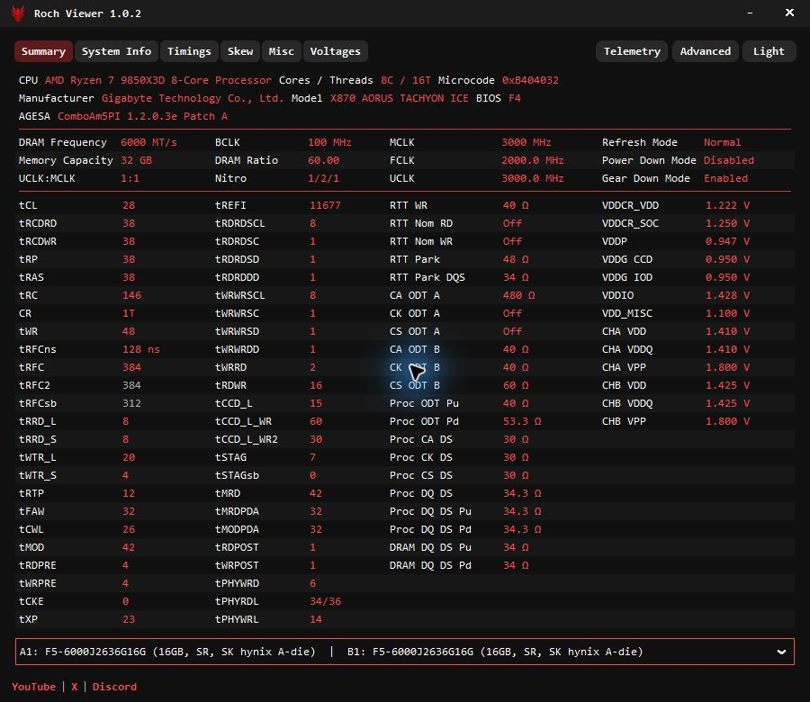
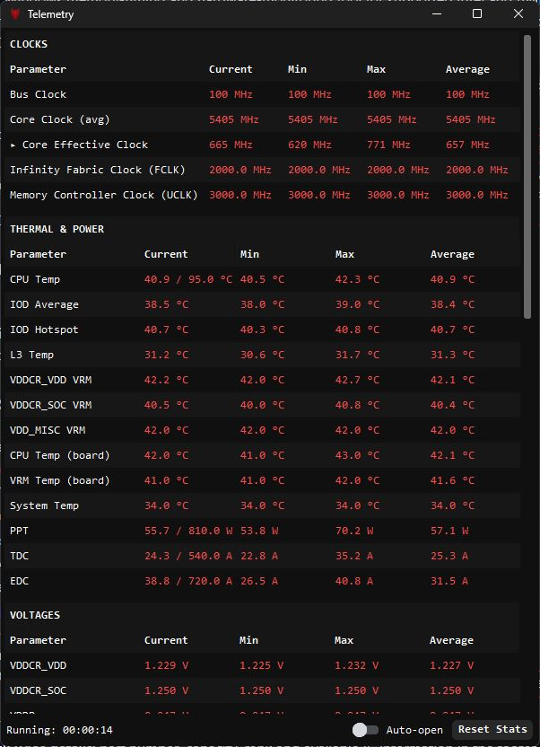
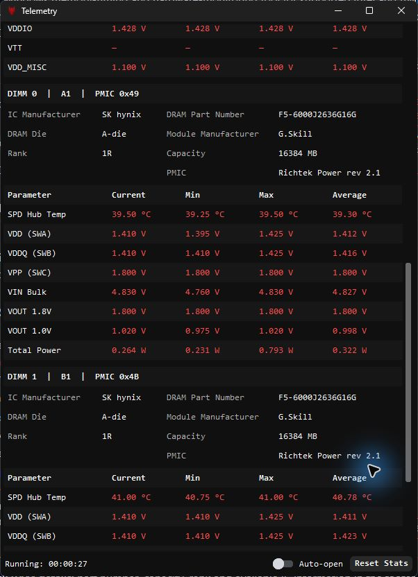

# Roch Viewer 1.1.1

The `main` branch contains the Rust version, currently **1.1.1**. The latest tagged release, [v1.1.0](https://github.com/RochStudio/Roch-Viewer/releases/tag/v1.1.0), was built from the earlier Python version. For the current Rust executable, use a successful `main` build from [GitHub Actions](https://github.com/RochStudio/Roch-Viewer/actions/workflows/tests.yml) or [build from source](#build-from-source).

Roch Viewer is a read-only Windows memory-timing and hardware-monitoring tool for supported Intel and AMD systems. Written in Rust with an egui interface, it displays clocks, timings, per-channel settings, RAM identity, motherboard sensors and native CPU/memory telemetry. It does not require HWiNFO.

The current Rust version includes:

- Native Rust hardware readers and an egui window, with readings collected on background threads.
- Summary, System Info, SPD, Timings, Training, IMC, RTL and Voltages tabs where supported, plus Advanced and Telemetry windows.
- A Settings window for themes, colours, fonts, interface scaling, window behaviour and live refresh timing.
- A customizable Summary: choose rows from any tab or Telemetry, arrange one to six columns, rename labels, and add headings or blank lines.
- A screenshot button that saves a PNG and can copy it to the clipboard.

See the [changelog](CHANGELOG.md) for the full list.

DDR4 RON is decoded from controller MR1 shadows. On the tested ASUS Z790-A D4 BIOS 3202 / microcode 0x11F system, 34/48-ohm BIOS selections produced matching displayed values with **DIMM RON Training** and **MRC Fast Boot** disabled. See [DDR4 RON validation](docs/ddr4-ron-validation.md) for the evidence and scope.

## Install

1. Open a successful `main` run in [GitHub Actions](https://github.com/RochStudio/Roch-Viewer/actions/workflows/tests.yml), download the `RochViewer-unsigned-no-driver` artifact, and extract `RochViewer.exe`. Alternatively, [build it locally](#build-from-source).
2. Obtain the 64-bit `inpoutx64.dll` from [Highresolution Enterprises](https://www.highrez.co.uk/downloads/inpout32/) and place it beside the executable. It is **not bundled**.
3. Open `RochViewer.exe`. It requests administrator privileges if needed; accept the Windows UAC prompt to read hardware registers.

Windows 10/11 x64 is required. The Rust executable needs no Python, .NET or Rust installation to run.

## Prerequisites

The InpOut DLL contains a kernel driver and can install a persistent Windows service on first elevated use. Windows security policies may block it; hardware-register readings then remain unavailable. Do not disable protections just to load it. Read the [driver details](docs/reference.md#prerequisites).

## Features

- **Summary:** CPU name, cores/threads, microcode, motherboard model/BIOS, memory speed, supported clock ratios, key timings, RTT/RON/VREF and voltage snapshots. Select one module or all modules; matching channel values display once and differences display side by side.
- **System Info:** system, processor and motherboard identity on the left, with configured clocks and graphics identity on the right.
- **SPD:** select a physical DIMM slot to see system channels and capacity, module identity and geometry, JEDEC timing tables, and supported Intel XMP 2.0/3.0 or AMD EXPO profiles read directly from the module. DDR5 details include profile voltages and the PMIC and SPD hub makers where available.
- **Timings:** primary, secondary and tertiary timings, including per-channel values where exposed, balanced across three columns without scrolling.
- **Voltages:** startup snapshots of every detected supported CPU, motherboard and memory rail. Use Telemetry for live readings.
- **Training and IMC:** supported RTT/ODT, RON, ODT delay, VREF, drive strength, power-down, refresh, mode-register and integrated-memory-controller configuration fields. Independent module/channel values remain visible where the hardware exposes them. AMD IMC includes native preamble/postamble and ECC status (memory-controller ECC, not DDR5 on-die ECC). Granite Ridge also exposes eight raw training codes with compatibility labels; those labels are not verified physical VREF/DFE readings. Unavailable reads stay blank.
- **RTL:** compact per-memory-controller/channel round-trip-latency values.
- **Native telemetry:** CPU/effective clocks, temperatures, power and supported motherboard voltages, plus each DIMM's temperature and PMIC rails. On the ASUS Z790-A D4, supported NCT6798D readings include Vcore, +5V, AVSB, 3VCC, +12V, VIN inputs, standby/battery rails, VTT, DRAM, CPU L2, CPU VCCSA, CPU AUX and motherboard/CPU/PCH temperatures. Current/minimum/maximum/average statistics and reset controls are included.
- **Per-stick RAM details:** part number, capacity, rank and available IC information in the footer and telemetry.
- **Shared Roch interface:** consistent toolbar buttons and YouTube | X | Discord links at the bottom-left.
- **Advanced view:** searchable decoded fields and a text dump for comparing configurations or reporting issues.
- **Read-only:** no overclocking controls or voltage writes. Low-level selectors and query transactions retrieve readings only.

## Window layout

Default window sizes depend on the platform and tab. These are the presets before interface scaling or a custom Summary layout:

| Tab | Intel LGA1700 DDR4 / LGA1851 | Intel LGA1700 DDR5 | AMD AM5 |
| --- | ---: | ---: | ---: |
| Summary | 775 × 775 | 700 × 750 | 700 × 750 |
| System Info | 780 × 750 | 775 × 750 | 788 × 750 |
| SPD | 750 × 750 | 700 × 816 | 700 × 816 |
| Timings | 750 × 750 | 700 × 750 | 750 × 650 |
| Training | 1010 × 800 | 975 × 950 | 700 × 650 |
| IMC | 750 × 1100 | 700 × 750 | 750 × 1100 |
| RTL | 750 × 654 | 700 × 750 | 750 × 654 |
| Voltages | 750 × 654 | 700 × 750 | 700 × 650 |

Only tabs supported by the active platform are shown. Windows grow from the bottom when switching tabs, keeping the title bar in place. On shorter displays, the requested height is capped with a minimum of 650; a custom Summary can grow to fit its contents.

## Settings

Open the gear in the title bar to change the appearance and behaviour. Changes apply immediately and are saved.

- Choose Light, Dark or Follow Windows, use a colour scheme, or edit individual colours for each mode. Adjust contrast, row shading and corner roundness.
- Choose an installed font, text size and row spacing, and scale the interface from 75% to 200%.
- Set always-on-top, window opacity, remembered window positions, the startup tab, Telemetry auto-open and the live refresh interval.
- Configure screenshot copying and footer links.
- Build your own Summary with one to six columns, rows from any tab or Telemetry, custom labels, headings and blank lines. Layouts are saved per platform, with an option to restore the built-in layout.

## Screenshots







These screenshots were captured before the Rust migration; the current interface and Settings controls may differ. Values shown are examples, not tuning recommendations.

## Hardware support

Intel LGA1700/LGA1851 and supported AMD AM5/Granite Ridge systems. Readings depend on CPU, memory type, motherboard, BIOS and driver access. DDR4 and DDR5 expose different fields; unsupported values stay unavailable, and motherboard sensor mappings are not assumed to transfer between models. See [validation history and limitations](docs/reference.md).

## Build from source

Install the stable Rust toolchain with [rustup](https://rustup.rs), using the `x86_64-pc-windows-msvc` target, and the Visual Studio C++ Build Tools with the Windows SDK. Then run:

```powershell
git clone --branch main https://github.com/RochStudio/Roch-Viewer.git
cd Roch-Viewer
cargo build --release --locked
```

Output: `target\release\RochViewer.exe`. Put the separately obtained `inpoutx64.dll` beside it. To run from a checkout, put the DLL in the project folder and use `cargo run --release`; the program looks in its own folder and in the folders above it.

Run the tests with:

```powershell
cargo test --workspace --locked
```

The normal test suite uses hardware substitutes. Tests that need a real bench are ignored by default, so a passing run does not validate live register readings on every supported system.

The workspace contains two crates: `crates/rochviewer` holds hardware access, decoders and platform tables; `crates/roch-viewer-app` builds the egui application. See [Contributing](CONTRIBUTING.md) and [Rust conventions](docs/rust-port.md) for development details.

## Credits

- **Ivan Rusanov (irusanov) — [ZenStates-Core](https://github.com/irusanov/ZenStates-Core) and [ZenTimings](https://github.com/irusanov/ZenTimings):** AMD register, timing and SMU references.
- **Highresolution Enterprises / Logix4u — InpOut32/64:** separately supplied low-level access component.
- **[LibreHardwareMonitor](https://github.com/LibreHardwareMonitor/LibreHardwareMonitor):** board-sensor register and mapping references.
- **Zorko — gnr-smu:** independent Granite Ridge SMU mailbox research.

Created by **Roch Studio / MateoPCTech**.

[YouTube](https://www.youtube.com/@MateoPcTech) | [X](https://x.com/MateoPCTech) | [Discord](https://discord.gg/KfzExpKQHB)

[License](LICENSE) · [Third-party notices](THIRD_PARTY_NOTICES.txt) · [Detailed reference](docs/reference.md)

> Low-level hardware access carries risk, even in a read-only tool. Provided as-is, without warranty.
